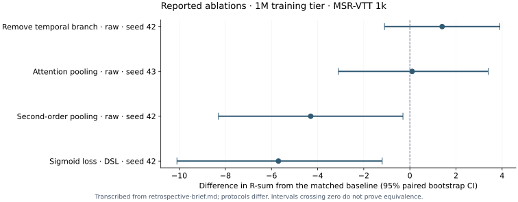

# MobileViCLIP experiments

I'm studying how much temporal modeling MobileViCLIP needs for video–text retrieval.
I started from the [official implementation](https://github.com/MCG-NJU/MobileViCLIP)
and compared changes to the temporal branch, pooling, and training loss on a 1M-clip
subset of InternVid. This repo contains those experiments, the evaluation tools,
and a separate investigation of the training captions.

## What I changed

My work builds on the original model and training code. I added temporal-branch
removal, alternative pooling heads, and a sigmoid-loss option, with separate configs
for the comparisons. I also added per-query rank logging and paired bootstrap
comparisons so I could look at the uncertainty in small retrieval differences.

The main changes are easiest to follow through these files:

| Change | Implementation | Check |
|---|---|---|
| Disable the temporal branch, then bypass its computation | [Model switches](models/mobileviclip_small.py) | [Zero-gate and bypass comparisons](tests/test_skip_temporal.py) |
| Compare pooling heads and a sigmoid loss | [Pooling heads](models/mobileviclip_small.py), [loss](models/criterions.py), [configs](experiments/configs/) | [Initialization and multi-positive loss checks](tests/test_optimization_components.py) |
| Compare retrieval runs query by query | [Paired bootstrap](experiments/paired_bootstrap.py) | [Resampling and scoring checks](tests/test_paired_bootstrap.py) |

The [model-change notes](model-optimization/docs/model-changes.md) explain the choices
behind each variant. The checks above test the implementation; the measured retrieval
comparisons are below.

## Results so far

Most of the changes did not give a reliable gain. Removing the temporal branch was
the most useful lead: its raw R-sum difference was **+1.40, with a 95% paired bootstrap
interval of [−1.10, +3.90]**. I would keep it for further efficiency testing, but the
interval is too wide to claim that accuracy is unchanged.



Attention pooling's initial gain did not hold up in the second seed. Second-order
pooling hurt the raw score, and the sigmoid loss hurt the dual-softmax score. Surprise
pooling collapsed to mean pooling. The [experiment summary](docs/RESULTS.md) has the
numbers, scoring conventions, and remaining questions.

I also examined a 10,000-clip sample of InternVid-zh with a model-assisted caption
audit. The lack of temporal descriptions led me to explore
[recaptioning from video frames](recaption/README.md). That is still a hypothesis to
test; I haven't completed the 10M-clip training or measured end-to-end mobile latency.

## Run a small example

The paired-bootstrap example runs on a CPU with Python 3.10–3.12. It uses synthetic
ranks, so there are no model or dataset downloads.

```bash
git clone https://github.com/rbybryan/mobileclip.git
cd mobileclip
python3 -m venv .venv
source .venv/bin/activate
python -m pip install -r requirements-demo.txt
python examples/paired_bootstrap_demo.py
```

This writes the comparison to `outputs/demo/paired_comparison.json`.
To run the associated tests and redraw the figure above:

```bash
python -m pytest -q tests/test_paired_bootstrap.py tests/test_collect_frame_select.py tests/test_release_environment.py
python scripts/plot_reported_results.py
```

The figure uses the committed experiment summary; the demo uses generated data.

## Run the model experiments

For training and checkpoint evaluation on Linux with an NVIDIA GPU:

```bash
ENV_NAME=mobileviclip bash scripts/setup_env.sh
conda activate mobileviclip
```

Download the inputs listed in [CHECKPOINTS.md](CHECKPOINTS.md), then follow the
[experiment guide](experiments/README.md) or [ablation commands](model-optimization/docs/run.md).
The [Chinese guide](README_zh.md) covers setup in more detail.
`requirements.lock.txt` is a snapshot of the earlier GPU environment; use the setup
script for training and `requirements-demo.txt` for the CPU example.

## References

The base model and training implementation come from
[MobileViCLIP: An Efficient Video-Text Model for Mobile Devices](https://arxiv.org/abs/2508.07312)
(ICCV 2025). The [original README](docs/UPSTREAM_README.md) and [MIT license](LICENSE)
are retained. Model weights, datasets, and other third-party components keep their
own terms. If you use these experiments, please cite the original paper and this repo
with the commit you used.
