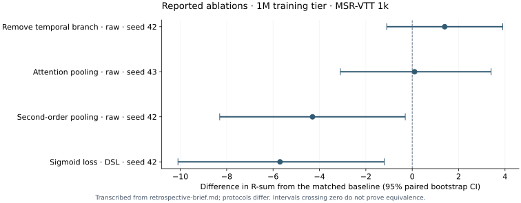

# Evidence and limitations

This repository extends the upstream [MobileViCLIP implementation](https://github.com/MCG-NJU/MobileViCLIP).
Reported research measurements below are transcribed from existing experiment reports;
the release-preparation checks do not rerun GPU training or regenerate those measurements.

## Reported ablations

The figure is generated by `python scripts/plot_reported_results.py` from
[`reported_ablation_summary.csv`](results/reported_ablation_summary.csv).
Its source is §3 of the [concise retrospective](../model-optimization/docs/retrospective-brief.md).
Training used a 1M-clip subset; evaluation used MSR-VTT 1k and 10,000 paired bootstrap resamples.
`R_sum` sums R@1/5/10 in both retrieval directions; it is not a percentage accuracy.
`raw` and dual-softmax (`DSL`) are different scoring protocols and must be labeled separately.
In the evaluator, `txt_*` means video-to-text and `img_*` means text-to-video.

Five distinct changes are listed in the public overview: temporal-branch removal,
attention pooling, second-order pooling, surprise pooling, and sigmoid loss.
Older notes call this a six-scheme round but do not consistently enumerate six distinct
changes in their summary tables. The public overview therefore does not repeat that count.

## What the results support

- Temporal-branch removal has a reported raw R-sum difference of +1.40,
  with 95% CI [−1.10, +3.90]. This interval includes both a small loss and an improvement.
  It is an efficiency candidate, not demonstrated accuracy improvement or equivalence.
- Attention pooling's initial gain did not persist in the reported second-seed comparison.
- Second-order pooling (raw) and sigmoid loss (DSL) have reported negative intervals.
- Surprise pooling is reported to collapse to mean pooling; it is not included in the
  numeric figure because the summary does not provide its paired interval.

The full retrospective mixes in-training evaluations and offline reevaluations, which
produce slightly different point estimates. The figure uses the paired-comparison table
as one consistent source, rather than combining its intervals with other point estimates.
Underlying per-query rank files are not committed, so readers can inspect the reported
measurements but need the original evaluation artifacts or a rerun to recompute them.

## Corrections to earlier interpretations

A confidence interval containing zero does **not** establish non-inferiority.
Earlier notes used an observed seed-variation threshold (δ=2.5 R-sum) as a screening rule.
That retrospective threshold is not a prespecified, substantively justified acceptable-loss
margin. No confirmatory non-inferiority or equivalence claim is made by this release.
Historical documents remain useful records of exploration; this interpretation supersedes
their older “non-inferior” / “非劣通过” wording.

The reported ~27.8% reduction in exported operator count and ~18% CPU mixer reduction
are distinct engineering measurements. They do not establish a corresponding reduction
in full-model latency, mobile-device latency, energy consumption, or memory use.
Export smoke tests also do not demonstrate trained-model quality.

The caption audit covers a 10,000-clip sample. Its model-assisted judgments and temporal
caption statistics are exploratory evidence for a recaptioning hypothesis, not proof
that caption quality caused the ablation outcomes or estimates for the entire corpus.

## Not demonstrated here

- Completed 10M-clip training or generalization of the ablations to that scale.
- A consistent improvement across datasets, seeds, and deployment devices.
- Human-validated accuracy of every model-generated caption judgment.
- A released trained checkpoint for the proposed changes.

## Reproduction levels

1. **CPU evaluator demo:** `python examples/paired_bootstrap_demo.py` uses synthetic
   ranks and exercises the real paired-bootstrap implementation. It is not a benchmark.
2. **Reported figure:** `python scripts/plot_reported_results.py` renders the supplied
   summary values without training or hidden data.
3. **Real checkpoint evaluation and training:** follow `scripts/setup_env.sh`,
   `CHECKPOINTS.md`, and `model-optimization/docs/run.md`. These require separately
   obtained data/weights and a compatible NVIDIA/Linux environment.
