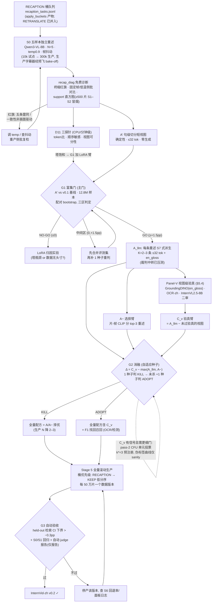

# 重字幕主计划 v1.1（Recaption Master Plan）— 两份方案的裁决与唯一执行线

> **日期**：2026-07-24（v1 上午定稿；**v1.1 同日终审修订**——三路专家终审后落地两条硬约束：
> ①**全计划零重人力标注**：所有有约束力的门一律自动化，人只做分钟级、无约束力的抽查
> （全计划合计 ≤75 分钟，见 D14）；②**可行性逐项落实**：验真面板选型到卡（§5.4 Panel-V）、
> 首轮融合测试降为视图级验真 C_v、G1 与 LLM 工具链解耦、§5.1 的 V100 全量后备档按真实吞吐
> 撤销。终审载荷见 §0.6，流程图见 §3。）
>
> **角色**：本文是重字幕工作的**唯一执行层**——
> [`caption-fusion-scheme.md`](caption-fusion-scheme.md)（五样本重述+融合）与
> [`data-quality-caprl-scheme.md`](data-quality-caprl-scheme.md)（CapRL 数据强化）两份设计
> 各自的分阶段清单（其 §6.2 / §7）**均被本文取代**；两份原文保留为设计依据与方法论论证，
> 不再照其执行。审计事实底座见 [`audit-10k-findings.md`](audit-10k-findings.md)。
>
> **一句话**：**S0 五样本重述照跑（已实现）；训练验证前置、验真与融合后置、人力标注归零**——
> 先用零工具风险的句切富集过训练门 G1，G1 过后由全自动 Panel-V 验真面板产出 C_v 臂做 G2
> 消融；完整 CFU 融合只作条件 pass-2；所有门的判据自动化，人只做分钟级无约束力抽查（D14）。

---

## 0. 对两份方案的裁决（评估结论）

### 0.1 两份方案共同的、经审计确认仍成立的判断（保留）

1. **重字幕是主力手段**（审计结论 10/12）：粒度粗 93.6%、整体质量差 19.6%、翻译差仅 3.6%
   → 「直接看视频写中文」一步同时解决对齐/粒度/翻译三类问题。RECAPTION 桶 25.3%。
2. **32-token 硬约束**（caprl §4.4）：任何稠密产物必须降维成 ≤32-token 短视图才进训练；
   时间戳不进对比文本，时序只用「先/然后/最后」措辞。
3. **S0 前端三决定**（fusion §1.1，已实现于 `--mode recap`）：五次**独立**调用（非一次吐五条）、
   temp 0.8–1.0 制造真方差、每样本帧相位抖动。这三条的论证扎实，不动。
4. **信任门精确优先**（fusion §0.3）：冻结文本塔下假单元=烧录的假对齐，失败代价不对称。
5. **一致性抓不住系统性幻觉**（fusion §3.5）：验真器必须异质（GroundingDINO/OCR/二号 VLM），
   同族自查无效——这条自我批判是两份文档里最有价值的方法论资产，全文继承。
6. **可证伪消融纪律**（fusion §6.4 / caprl P0）：融合必须在等预算下同时 ≥ uniform 与 ≥ best-single
   才算成立，不预设结论。

### 0.2 对 `data-quality-caprl-scheme.md` 的修正

| # | 问题 | 裁决 |
|---|---|---|
| C1 | **两条训练线混写**：方案按英文线（MobileCLIP-S2 / MSR-VTT / CapRL-Video-4B 英文字幕器）立论，但重字幕的当下主战场是中文线（NebulaCV-24M / MiniRBT 冻结文本塔 / InternVid-zh） | 两线**分开钉**（§2 D1）：zh=Qwen3-VL-8B 直出中文（已实现、已论证）；EN=CapRL-Video-4B（paper 线 C1，归 `paper-plan.md` U7 所有） |
| C2 | **P0 一步到 3M×K≈9M 次生成**，缺中间决策门 | 改为 300k 子集 → G1 训练门 → 全量（§3 Stage 3/5）；全量前必须有子集级证据 |
| C3 | Pillar C（tags/硬负）、Pillar D（教师嵌入/KD）的所有权已被 `paper-plan.md` §7 / U7 / U9 收编 | 本计划**不重复规划**，只保留接口（§6 砍掉清单、§2 D9） |
| C4 | §8 「原始字幕保留为采样视图之一」被当成普适护栏 | 只对 **KEEP 桶**成立；**RECAPTION 桶成员的原字幕是实测差的字幕，不得回流为训练视图**（§4） |

### 0.3 对 `caption-fusion-scheme.md` 的修正

| # | 问题 | 裁决 |
|---|---|---|
| F1 | **顺序倒置**：150–300 片逐单元人评标定（人·日级，全计划最贵的人力项）排在任何训练证据之前（其 F0 在训练验证前就要标定 k\*） | **训练门 G1 先行**（零人力），标定后置（v1 裁决）；**v1.1 进一步归零**：C_v 路线使人力标定整体出局，k\*=3 预注册 + Panel-V 伪标签 sanity（§0.6-1、§5.2） |
| F2 | §6.4 消融的 **arm A 未定义 32-token 处理**：五条稠密重述「直接 uniform」会被截成半句，消融混淆「融合价值」与「长度处理」 | 视图阶梯统一定义于 **D5**（G1 用确定性句切 A′；G2 各臂共用同一 LLM 派生格式），全部服从同一 ≤32-token 规则 |
| F3 | S4 用 GroundingDINO 验物体存在性，但它是**英文词表**检测器，而单元是中文——方案未给桥 | S1 分解时每单元**顺带产 `en_gloss`**（同一次调用多一个字段，近零成本），F1 验真用之（§2 D8） |
| F4 | §4 schema 示例里 RECAPTION 片仍保留原字幕作视图 | 同 C4，删（§4） |
| F5 | §3.4 要求 onscreen_text「必须过 OCR 才进融合稿」，但 OCR 验真器在 F1 才建——**F0 期该门无着落** | F0 期守恒策略（§2 D7）：`onscreen_text` 一律不进融合稿、`count` 一律降级模糊量词；F1 用 OCR **找回**文字召回。消融解读时预登记：若 C 臂恰在含屏幕文字的片上输给 A，归因于此，是 F1 的启动理由而非融合的失败 |
| F6 | 全量成本按 V100-HF 后端不现实（10M 桶级 ≈ 数十天） | 算力分档（§5）：V100-HF 只跑 10k 级试点；300k 级起用 H100+vLLM；Stage 0 顺带实测吞吐，填进成本表再排全量 |

### 0.4 一条本计划新增的、两份原文都没有的保险

**G1 失败 ≠ 数据方向死刑。** fusion §7 已诚实指出：冻结 32-token 文本塔可能把「更好字幕」的
收益在编码端抹平。若 G1 富集臂不涨点，在放弃前**必须**先跑一次便宜的归因实验：同一 arm-A 数据
+ 文本塔 LoRA（或解冻末层）短训。数据好而塔瓶颈 → 病灶在塔，方向转向「文本侧微调」；
LoRA 也不涨 → 才是数据/任务本身无头寸。不做这步就下结论，会把「塔的问题」误判成「数据的问题」。
且这一风险可以**提前预警**：D11 探针 (iii)（视图可分性）若显示冻结塔对候选短视图已饱和
（片内视图两两余弦过高），则 G1 从一开始就带 LoRA 臂，而不是等失败后再补。

### 0.5 外部评审补强（2026-07-24，两份独立评审的载荷结论）

本计划定稿前经两路独立评审（VLM 方法论 + 统计设计），采纳如下（引用见 §9）：

1. **融合的先验要诚实地写低**。2024–26 没有任何发表证据表明「N 样本融合」在对比训练上优于
   「K 条候选逐步采样」：MobileCLIP 存 5 条 CoCa 字幕但增益集中在前 1–2 条（2311.17049）、
   MobileCLIP2 在 2 条合成字幕即饱和（2508.20691）、CLIPS 甚至证明**只采稠密字幕的子片段**
   好于用整条（2411.16828，丢信息反而涨点）。机制上，**逐步 uniform 采样在期望里就是软性
   support 加权**——一个 support=1 的幻觉单元只在极小步数占比里进梯度；融合是把这个软投票
   硬阈值化，同时牺牲被验证过的多样性杠杆。→ 预期 **C ≈ A**；融合保留为门控假设（§3 Stage 4），
   不预支任何工程。
2. **但「G1 零效 ⇒ 融合无用」不成立**（统计评审）：融合的机制是移除 A 臂里被烧录的幻觉——
   若幻觉损失恰好抵消富集收益，「C>A≈基线」正是融合预测的图景。→ **G1 的 NO-GO 只裁「重述
   通道」，不裁融合**；融合生死只由 G2 的直接对比裁（§3 G1/G2 判据即按此写）。
3. **更便宜的共识先上阶梯**：best-of-N 选择在视频规模有已发表实证（Panda-70M 以检索分选多
   教师最佳字幕，预训练 +7.0 MSR-VTT R@1，2402.19479）。「保 top-3 重述 + 弃底」以 ~5% 的
   工程成本捕获融合可及价值的大部分 → 设为 **A− 选择臂**（§3 Stage 4），C 必须同时赢 A 与 A−。
4. **冻结文本塔是已知弱配置**：LiT 原文自己就报「锁文本塔效果不佳」（2111.07991），而全部
   合成字幕收益都是在**可训文本塔**下测得的；CLIP 类文本塔有效长度 <20 token（Long-CLIP
   2403.15378）进一步压密度收益的天花板。→ D11 新增探针 (iii)，饱和即触发 0.4 的 LoRA 臂前置。
5. **字幕器与采样数**：H100+vLLM 上 Qwen3-VL-30B-A3B（激活 ~3B）单条成本 ≤ 8B dense 且质量
   更高 → Stage 3 预飞 bake-off 后定（V100 装不下 30B 总参，Stage 0 维持 8B 不变）。评审建议
   N 降到 2–3（多样性在 2 条即饱和）；**本计划维持 N=5**，分歧记录在案——理由：同一批产物要
   喂 A/A−/C 三臂 + 规模化投票诊断，N=3 只省约一天 H100 空档却废掉 G2 的干净测试与 5 档
   support 分辨率。若 G2 裁掉融合，Stage 5 全量生产即降为 N=2–3（届时只剩 A/A− 消费）。
6. **勘误（fusion §7）**：「缓存视觉塔前向、解码 5 次摊薄成本」在**帧相位抖动下不成立**——
   每样本帧不同，prefill 无法复用，5× 生成成本是真成本。成本表按真 5× 排（§5.1）。
7. **标定预算大幅收缩**（统计评审）：按**单元分层**（support 层 × 常见类别）标 ~600 个判定
   （≈1 人·日）即可支撑 k\* 四选一；整片全标（1,500–6,000 判定）是 5–10× 浪费。高风险类别
   （onscreen_text/count）**零决策标注**、预注册 always-verify——证明「可信任」所需的标注量
   （~60 个零错高支持单元 ≈ 标 300+ 片）远贵于直接验真。协议细节见 §5.2。
   （**v1.1 已再进一步**：连这 ~600 个人力判定也被撤销——见 §0.6-1/§5.2，标定改为
   Panel-V 伪标签 + 预注册 k\*=3，人力归零。）

### 0.6 终审载荷（v1.1，2026-07-24；三路专家终审：自动评测设计 × 统计效度 × 可行性）

1. **人力标定整体出局**。首轮融合测试改为**视图级验真 C_v**（= A 臂视图并集 − 未过
   Panel-V 验真的视图）：它直接实现融合的机制主张（去幻觉，0.5-2），工程量 ≈ 单元投票
   机器的 5–10%，且让 k\* 标定**从关键路径上消失**。完整 CFU（S1–S3 单元投票 + S5–S7
   整合）降为「诊断冒烟 + 条件 pass-2」：仅当 C_v 显示信号且需要更精细的门时才做，
   届时 **k\*=3 预注册**、Panel-V 伪标签曲线只作免费 sanity 报告（升 4 的例外条件见 §5.2）。
2. **伪标签标定的效度条件已形式化**（统计终审）：验真器误差须**对 support 非差异**
   （分类别 Se/Sp 不随 support 变、Youden J>0）→ 伪精度是真精度的保序仿射映射，
   **尺度无关的选择规则不变**；因此 §5.2 的绝对精度目标规则被换成**相对间隙规则**。
   失效方向 = 验真器与字幕器共享先验幻觉 → 高 support 伪精度被抬高 → k\* 偏低；
   诊断 D1–D3（§5.2）全免费，任一失败 → 回落 k\*=3，**任何情况下不接受伪标定给出的 k\*<3**。
   另一处更正：**S6 自验收并不兜底阈值误标**——它只对照 trusted 单元表打分，只兜
   整合阶段的新增幻觉；阈值失误的真实兜底是 G2 本身（误标的 C 必须仍赢 +1.0pp 才会被采纳，
   损失形态是假 KILL/机会成本，不是语料污染）。
3. **G2 种子预算自适应化**：固定 3×3 臂·种子（~10 跑）→ **先 1 种子/臂 + 合并评测集
   （~3k query）判 KILL，未杀再给 C_v 与最强对照臂各 +1 种子**；ADOPT 永不出自单种子，
   CI **必须含种子方差项**（否则假 ADOPT 率 8.1%→含项后 4.4%）。期望新增训练数：
   零效应 3.0、+1.5pp 效应 3.8（对固定设计省 ~60% 算力，功效几乎不变：+1.5pp 37%、
   +2.5pp 72%——低功效于经济边际是有意的：不确定 → KILL）。σ_seed 用 3 次基线重复实测
   （新增 2 次，兼作 G1 中间区的补种子）。
4. **G1 与 LLM 工具链解耦**：G1 主臂**降级回确定性句切 A′**（CLIPS/DreamLIP 先例在案）——
   per-recap LLM 派生（A_llm）、裁判中转压测、JSON 修复链全都移出主门关键路径，挪进
   Stage 4；代价 = G2 需新跑 1 个 A_llm 种子（~0.5–1 天 4×H100），换来 G1 提前数天且
   零工具风险。格式效应仍在 G2 内被 A′ 行量化。
5. **验真面板选型到卡**（可行性终审，§5.4）：主判 **InternVL2.5-8B**（双塔均非 Qwen——
   全场唯一强候选；~19–20GB fp16 峰值，V100-32G 放得下）；快速备选 **MiniCPM-V-4.0**
   （SigLIP2+MiniCPM4-3B，非 Qwen）；升级档 InternVL2.5-26B 跨 2 卡。**否决**：
   LLaVA-OneVision / MiniCPM-V-2.6 / 4.5 / Molmo / InternVL3-8B（内藏 Qwen LLM，
   与字幕器去相关失败）、GLM-4.1V（thinking 吐几百 token，V100 吞吐不可用）、Phi 系（zh 弱）。
   GroundingDINO 用 transformers 原生类 fp32（免编译 CUDA 扩展，SM70 可用）；OCR 用
   PaddleOCR 独立 venv 或 RapidOCR（onnxruntime）。每个验真器一个 venv、jsonl 进出。
6. **两处硬修正**：§5.1 的「V100 后备档 ~7 天」按本计划自己的 Stage-0 锚点推算实为
   **25–118 天，撤销**——H100 空档升级为 Stage 3 硬前置（真后备 = N=2×120k 缩减设计并
   如实标注）；审计环境是 torch 2.5.1（非训练环境的 1.13），验真器兼容性按此评估。
7. **约束力自动化原则（新增 D14）**：G0–G3 所有门的判据 = 检索回归（配对 bootstrap）+
   自动化面板/裁判指标；人只做分钟级、无约束力抽查（Stage 0 目检 ~20 分钟、Stage 3
   bake-off ~15 分钟、G3 分歧样本 ~15 分钟、D10 译文抽掠 ~30 分钟可选——合计 ≤75 分钟，
   任何一项跳过都不阻塞任何门）。裁判纪律沿审计教训：拆分单一判据调用、绝不合并 rubric、
   Qwen3.6-27B 只用于纯文本轴（它看不见画面，且与字幕器同族）。

### 0.7 检索增补（2026-07-27，两路带网络检索专家评审；完整证据见 notes/caption-kd-review-2026-07.md）

约 55 篇 arXiv 逐一取原文核验。头条：**阶梯无更优替代**——A′ 32-token 恰是 CLIPS
（2411.16828）实测最优 token 长度；融合降级获视频原生新证（2401.06129：全语料重述
+3.8 R@1 而 LLM 合并仅 +0.3 边际）；C_v 独立验真领先文献。采纳修正如下：

1. **消费上限（修 D5 消费侧）**：MobileCLIP2（2508.20691）两条合成字幕即饱和 →
   N=5 只作选择/验真池，**训练消费 ≤2–3 条重述的视图**（A− top-3 已天然满足；
   A′/G1 臂补同等上限：句切池按重述分组取前 2–3 组）。
2. **覆盖扩展预案（挂 G1 后决策）**：全语料重述证据（2401.06129；Nguyen 2307.10350
   sub-100M 规模改写>过滤）指向审计 93.6%「对但粗」的大多数 → KEEP 桶 **N=2 低配
   增补、原字幕并列保留**（D6 不变：RECAPTION 桶原字幕仍不回流）；G1 300k 试验
   预留 +KEEP-tier 臂位。
3. **门指标补强**：G1/G2 加**零样本动作分类守门**（Xray 2602.16918 实录：合成字幕
   检索升/分类降）+ **原生中文评测**（Youku-mPLUG 检索子集）与译测 MSR-VTT-zh
   同报，双向一致才算过。
4. **冻结塔警告升级**：全部文献无「冻结非对比文本塔」成功先例（LiT 自陈锁文本塔
   不行；LanguageBind 冻的是已对齐 CLIP 塔；Chinese-CLIP 终局全解冻）→ 0.4 的
   LoRA 臂由「应急」升格为「**大概率需要**」；G1 失败先疑塔后疑字幕。免费诊断补
   一件：250 片样本上算 MiniRBT 编码的片内视图两两余弦（**冻结塔散度**——Jaccard
   多样 ≠ 冻结塔空间多样），与 D11-iii 同族并跑。
5. **新门控臂候选 CaRe-DPO**（2509.16560，Stage 4 后可选）：chosen = top-of-5 ∧
   验真过 / rejected = bottom ∨ 验真败 → LoRA-DPO 字幕器（8×V100 可跑）重产
   RECAPTION 桶；零人工；证据间接 → G2 式 Δ 门。
6. **Qwen 特征搭车蒸馏裁决**（答维护者问）：原版 MobileViCLIP **无蒸馏步**（核验
   论文：纯 VTC InfoNCE，全文无 distill；蒸馏只经 MobileCLIP-S0/S2 初始化间接进入）。
   Qwen 作 KD **主教师否决**：无对比对齐空间（vtc_kd 不可算，LLM2CLIP 反证）、
   覆盖 25% 偏置桶（成对信号 ~6%）、生成式→对比式特征蒸馏零发表先例、省下的
   ~17 H100·h 与 InternVideo2-1B 全语料 pass（~21 H100·h，4×H100 实际 1–2 天）
   同量级。**白捡字节做 U9 一行 `+geo(Qwen)` 消融 = 有条件可**（CKA 前置门 +
   不得迫使重述离开 vLLM），归 paper-plan U7/U9 所有（§6 边界不变：zh 线不做 KD）。
7. **自证无虞**：A− 打分器已是多语言 `google/siglip2-so400m`（英文打分器乱选
   top-3 的风险不存在）；bundle 回来看 5 重述分差区分度即闭环。

---

## 1. 事实底座（一屏读完）

| 项 | 事实 | 出处 |
|---|---|---|
| 两条训练线 | **zh 线**：NebulaCV-CLIP-24M（FastViT-MCI0 + MiniRBT-H288 中文文本塔，冻结、仅 MLP 投影可训，max_txt 32），InternVid-zh 11 分片，b100 与 wky/zyc 协作；**EN 线**：MobileViCLIP 复现+论文（CVPR'27，R0–R3，4×H100） | `b100-local-changes.md`、`paper-plan.md` |
| 审计定论 | 粒度粗 93.6% / 质量差 19.6% / 翻译差 3.6% / RECAPTION 桶 25.3% / RETRANSLATE 并入 RECAPTION（结论 13）| `audit-10k-findings.md` |
| 已实现 | S0 五样本重述全链：`RECAP_PROMPT` + `vlm_audit_hf.py --mode recap`（N=5、temp 0.9、帧抖动）+ `run_v100.sh recap`（8 卡分发、可续跑）；输入队列 `$OUT/v0_2/recaption_tasks.jsonl`（`apply_buckets --out-recaption` 产物） | #215/#216 |
| 已实现（2026-07-24 晚补） | `split_views.py`（A′ 句切+单测）、`recap_diag.py`（坍缩诊断+侧批对照）、`make_recap_tsv.py`/`recap-tsv`；**全链条样本档**：`--mode derive`（A_llm 派生+en_gloss）、`score_alignment --tag` 透传（A− 选择）、`fuse_verify.py` v0（Panel-V 检测器档：GDINO fp32 + RapidOCR，缺件自动降级）、`make_pipeline_tsv.py` + `run_v100.sh pipeline-sample`（50 片端到端 ~1h，全景 TSV） | Stage 2-1/2/5/6 样本档；`tools/data_audit/README.md` |
| 未实现 | Panel-V **VLM 二审档**（InternVL2.5-8B venv + 路由/升级/噪声自校准，§5.4 完整版）、`fuse_captions.py --mode decompose`（S1–S2 冒烟；S3–S7 仅 pass-2）、中转压测、D11 探针脚本、300k 生产档编排 | Stage 2 清单剩余 |
| 消费端 | `pt_dataset.py` uniform 模式**只读 `captions` 列表**；原字幕想当视图必须显式放进列表。⚠️ `min_caption_length` 按 `split()` 数词——**中文无空格恒为 1**，zh 配置必须 ≤1，否则静默全滤 | `pt_dataset.py:173-201` |
| 算力 | 101vector 8×V100（HF 后端、审计/试点）；b100 8×H100（论文线默认前 4 卡；vLLM 可用；**优先级=EN 论文线**，zh 大批量用空档并先打招呼） | `SETUP_B100.md`、`plan-review-upgrades.md` U6 |
| EN 线接口 | C1 需每片 ≥2 条合成短字幕（CapRL-Video-4B，10M ≈ 3–6 天 @4×H100，vLLM） | `plan-review-upgrades.md` §3.6、U7-3 |

---

## 2. 定论表（本计划做出的选择，每条一行理由）

| # | 决策 | 理由 |
|---|---|---|
| D1 | **前端分线钉死**：zh = Qwen3-VL-8B `RECAP_PROMPT`、N=5、temp 0.9、帧抖动（不动）；EN = CapRL-Video-4B（形态经 1k 试点在「prompt 约束 K 条短句」vs「稠密+句切」二选一，归 paper-plan 执行） | zh 直出避开翻译级联且已实现；EN 器为论文故事与吞吐最优 |
| D2 | **融合不上任何关键路径**：EN 论文线 C1 不引入融合；zh 线融合只在 G1+诊断双绿灯后启动 | deadline 红线；未经验证的机器不背关键路径 |
| D3 | **G1 = 300k 均匀子集「富集」试验**，不是「只修 25% 桶」试验 | 粒度粗 93.6% 是全语料病，富集测的才是主效应；均匀抽样免除桶置信度混淆；12.8M 样本/臂对齐仓库消融惯例 |
| D4 | **N=5 一次产齐**（300k×5，不为 G1 单独产 N=2）；字幕器经 Stage 3 预飞 bake-off（8B vs 30B-A3B @H100+vLLM）后定 | 同一批产物喂 G1（arm A）+ G2（arm A−/C）+ 规模化 support 诊断；重跑比一次产齐更贵；评审分歧见 0.5-5 |
| D5 | **视图阶梯定稿（v1.1）**：**G1 主臂 = A′ 句级切分**（`。；！？`切、超长按`，`再切、MiniRBT 实测 ≤32 tok、仍超长丢弃；确定性、零生成、零工具风险）。**G2 三臂**（全部同一 LLM 派生格式）：**A_llm** = 对每条重述各做一次 S7 式短视图派生（K=2–3 条 ≤32 tok）取并集；**A−** = A_llm 视图但只保片-帧 CLIP 分（NebulaCV-24M 冻结初始权重，b100 打分）top-3 重述；**C_v** = A_llm − 未过 Panel-V 验真的视图。**B（best-single）**= 可选 | G1 与 LLM 工具链解耦（0.6-4）；G2 三臂只差一个算子（并集 / 选择 / 验真过滤），归因干净；A− 是 Panda-70M 式选择（0.5-3）；A′ 有 DreamLIP/CLIPS 先例且其 G1 跑进 G2 作格式效应对照行 |
| D6 | **原字幕去留按桶**：KEEP=保留为唯一/其一视图；RECAPTION 桶=不回流 | 见 0.2-C4 |
| D7 | **F0 高风险类别守恒策略**：`onscreen_text` 不进融合稿；`count` 一律模糊量词 | 见 0.3-F5；无验真器期的精确优先 |
| D8 | **`en_gloss` 随视图产**（v1.1：从 S7/派生调用顺带输出，而非 S1）——每条视图附英文名词短语表，GroundingDINO 验真用它查询 | 见 0.3-F3；C_v 是视图级验真，gloss 挂视图比挂单元更直接 |
| D9 | RETRANSLATE 并入 RECAPTION（全量不再维护独立通道）；FIX_TEXT/DROP 照旧文本侧；tags/硬负/教师嵌入归 paper-plan U7/U9，本计划只保证 schema 兼容 | 审计结论 13；所有权单一 |
| D10 | **zh 评测集钉死**：门控指标 = 2k held-out **KEEP 桶**片内检索（字幕经审计、干净）；报告指标 = MSR-VTT-1k 查询一次性机翻中文，QC **全自动**（v1.1）：确定性检查（数字/实体存活，复用 `strip_shared_latin` 修复版）+ 27B 走 s2-trans 已验证调用形态 + NLLB 异族回译 + LaBSE 极尾离群规则（尊重审计结论 2/9：LaBSE 只在极尾有信号）→ 离群自动重翻，二次失败即弃（预期 <2%）；**评测集在任何臂比较前冻结**（翻译噪声两臂共享 → 只损灵敏度不偏 Δ）。维护者可选 ~30 分钟抽掠，无约束力 | 用 v0.1 噪声字幕当验证集会系统性低估富集收益；KEEP 桶是现成的干净集；QC 自动化见 0.6-7/D14 |
| D11 | **三个 10 分钟级探针（v1.1：`hfl/minirbt-h288` 可直接 HF 下载，101vector CPU 即可跑，不等 b100）**：(i) MiniRBT 对重述样本的实测 token/字比（钉视图字预算）；(ii) 冻结文本塔顺序敏感探针（1k 对顺序互换句余弦）——zh(MiniRBT) 与 EN(MobileCLIP-S2) 各一次；(iii) **视图可分性探针**：冻结 MiniRBT 编码 ~1k 片的候选短视图（用 Stage 0 产物 + split_views），报片内视图两两余弦与「视图↔原字幕」余弦分布 | (i) 决定 D5 阈值；(ii) 决定 temporal_order/硬负线是否需 LoRA（caprl §6.3 提出后一直没人跑）；(iii) 预登记：片内两两余弦中位 >0.9 = 塔已饱和 → G1 直接带 LoRA 臂（0.4/0.5-4）。注：(ii)(iii) 的 NebulaCV 投影头若不易取，仅 MiniRBT 裸塔近似即可（结论只用于触发 LoRA 臂，非精密测量） |
| D12 | **better_zh 存档**：不再生产分面候选；10k 轮 s4-merged 落地产物仅供回归对照 | fusion §0.1 论证其投票机制自相矛盾 |
| D13 | **统计判定权属预登记**：G1/G2 用三区规则 + 配对 bootstrap + **自适应种子表**（§5.3），冻结后不临场改 | 审计三次代理指标教训的流程化（audit 结论 15）；评审 0.5-2/0.6-3 |
| D14 | **零重人力标注原则（v1.1）**：任何有约束力的门（G0–G3、KILL/ADOPT、rollout 验收）只允许自动化判据；人只做**分钟级、无约束力**的抽查（全计划合计 ≤75 分钟，逐项列于 0.6-7），任何一项被跳过都不阻塞流程 | 用户硬约束；维护者时间是全计划最稀缺资源；audit 结论 8'/14/15 的裁判纪律（拆分调用、异族测量、代理先验证）使自动化可信 |

---

## 3. 执行阶梯（唯一时序；门未过不得进下一段花钱步骤）

**重述与精炼全流程图（v1.1；GitHub 渲染 mermaid，纯文本阅读看下方阶梯表）**：



```
Stage 0  (V100, 现在)   10k 试点重述 + 侧批 + 免费诊断 + 三探针(CPU) → 吞吐实测、坍缩检查
Stage 1  (b100, 在途)   zh v0.1 基线数据 + 基线训练              → G0: 基线可复现
Stage 2  (Claude)       工具: split_views / recap_diag / 派生+验真面板 / 中转压测
Stage 3  (H100 空档=硬前置) 300k×5 重述 → A′ 数据 → 12.8M 样本×2 臂 → G1: 富集 vs 基线
Stage 4  (G1 过后)      A_llm/A−/C_v 数据 + Panel-V → 自适应消融   → G2: 验真/融合是否成立
Stage 5  (G2 裁决后)    全量生产: 胜者配方, 桶优先级 rollout        → G3 自动验收
Stage 6  (paper 线)     CapRL-Video-4B 英文字幕 pass — 归 paper-plan, 本计划仅供 schema
```

### Stage 0 — 10k 试点重述 + 诊断（V100，本周可跑，零人力）

前置：10k 轮 `s3` + `s4`（apply_buckets）已产 `$OUT/v0_2/recaption_tasks.jsonl`（2,532 片，
RETRANSLATE 已并入与否以 apply_buckets 当前行为为准，量级不变）。

```bash
# ① 五样本重述（2,532 片 × 5 ≈ 12.7k 次生成 ≈ 1.3× 一遍 s2 的生成量, 8 卡当天级）
bash tools/data_audit/run_v100.sh recap
# ② 跑完记录吞吐（填 §5 成本表；这是全量排期的唯一可信输入）:
#    grep -c . $OUT/recap5.*.jsonl ; 用日志时间戳算 片·样本/秒/卡

# ③ 两个侧批诊断（各 ~300 片, 主批跑完后再跑或占 2 张空卡; 服务于 §7 的相关性诊断）:
head -n 300 "$OUT/v0_2/recaption_tasks.jsonl" > "$OUT/v0_2/recap_diag300.jsonl"
#   (a) 固定帧对照 —— 量化「一致性是否由画面驱动」(support 直方图应与主批显著不同):
CUDA_VISIBLE_DEVICES=0 python tools/data_audit/vlm_audit_hf.py \
  --input "$OUT/v0_2/recap_diag300.jsonl" --video-root "$CLIPS" \
  --model Qwen/Qwen3-VL-8B-Instruct --mode recap --n-captions 5 --temperature 0.9 \
  --no-frame-jitter --num-shards 1 --shard-id 0 --output "$OUT/recap5_nojit.{shard}.jsonl"
#   (b) 低温对照 —— 量化「先验驱动核」(两温下都 5/5 一致的单元 = 模型先验, 非画面证据):
CUDA_VISIBLE_DEVICES=1 python tools/data_audit/vlm_audit_hf.py \
  --input "$OUT/v0_2/recap_diag300.jsonl" --video-root "$CLIPS" \
  --model Qwen/Qwen3-VL-8B-Instruct --mode recap --n-captions 5 --temperature 0.3 \
  --num-shards 1 --shard-id 0 --output "$OUT/recap5_t03.{shard}.jsonl"
```

**建议先抽样后全量**（工具已就绪，`tools/data_audit/README.md`「重述抽样检验」节）：
`head -n 50` 队列 → `RECAP_INPUT=… recap`（几分钟）→ `recap-tsv` → 目检
`recap_inspect.tsv`（**源caption(en) / 翻译源caption(zh) / 5 条重述 / A′ 句切视图**并排
+ COLLAPSE 旗）。抽样与全量共用输出文件、按 video 去重续跑，零浪费。

**产出与验收**：
- `recap5.{0..7}.jsonl` 覆盖 ≥95% 队列 + 两个侧批产物就位；
- **温度坍缩检查**（`recap-tsv` 自动跑 recap_diag）：五条重述需有实质差异；
  预登记红旗 = 成对字符 3-gram Jaccard 中位数 > 0.8（≈五条近乎雷同）→ 升 temp / 查抖动；
  侧批到位后用 `recap_diag.py --compare` 出对照摘要；
- 三探针（D11，101vector CPU 即可）结果记入本文件附录；
- TSV 目检 ~20 分钟（无约束力，D14）：重述是否明显好于旧翻译、A′ 视图是否成句。

### Stage 1 — zh v0.1 基线（b100，已在途）→ **G0**

按 `notes/live/from-claude.md` 的 §2 返工指引继续：conda py3.10 环境 → 11 分片数据装配 →
NebulaCV 基线训练。**G0 = 基线训练收敛且在 D10 两个评测集上出数**。没有 G0，后面一切比较无锚。
（检查项：zh 配置 `min_caption_length ≤ 1`，见 §1 消费端陷阱。）

### Stage 2 — 工具落地（Claude 侧，与 Stage 0/1 并行）

优先级从高到低（1–3 服务 G1 关键路径；4–6 服务 Stage 4，可后到）：

1. `tools/data_audit/split_views.py`：稠密重述 → 句级短视图（A′ 规则，MiniRBT tokenizer 实测
   截断；**切分后空视图/纯标点视图丢弃**）；输出直接是 `captions` 列表补丁。含单测
   （超长句、混杂标点、空重述）。**G1 只依赖这一件生成工具。**
2. `tools/data_audit/recap_diag.py`：读 `recap5*.jsonl`（主批+侧批），报：每片五条长度分布、
   成对 3-gram Jaccard / LaBSE 余弦、语料级坍缩红旗；**主批 vs 固定帧侧批的 support 直方图
   TV 距离**（红旗 <0.05：一致性非画面驱动）；**两温交集 5/5 率**（先验核占比，分类别）；
   **类别 5/5 率排序**（红旗：onscreen_text/count ≥ subject——最弱类别最自信 = §3.5 signature）。
3. D11 三探针脚本（101vector CPU 即可，`hfl/minirbt-h288` 直接 HF 下载）。
4. **裁判中转压测**（Stage 4 前置）：`SETUP_JUDGE_RELAY.md` 的 27B 端点持续并发 ≥64 的
   吞吐实测——300k 级派生（~1.5M 次短调用）能否 1 天内走完、与论文线的窗口如何错峰，
   都由这个数字决定。
5. `tools/fuse_captions.py` 两个模式：`--mode per-recap-views`（对**单条**重述跑 S7 式派生，
   K=2–3 条 ≤32 tok 互补短句 + 每视图 `en_gloss` 名词短语表——A_llm 的生产工具，与 pass-2
   融合共用同一派生提示；附带片-帧 CLIP 打分列供 A−/B）；`--mode decompose`（S1 分解 + S2
   对齐计票——**诊断冒烟与 pass-2 用**，S3–S7 完整 CFU 只在 pass-2 触发时补全）。
6. `tools/fuse_verify.py`（**Panel-V 视图级验真**，§5.4）：GroundingDINO(transformers 原生,
   fp32) 按 `en_gloss` 查询 → OCR（含屏幕文字的视图）→ InternVL2.5-8B 二元 QA（always-verify
   类别 + 检测器边界 + 5% 抽审）。每验真器独立 venv、jsonl 进出；含错标噪声自校准
   （错配片置换对照 + 27B 生成 foil，全自动）。

就绪后在 Stage 0 的 recap5-10k 上端到端冒烟（`--mode decompose` 覆盖 **≥500 片**），产出
第一份 **support 分布报告**。**「投票有信息」判据（预登记，pass-2 的入场券）**：按常见类别
P(5/5) ≤ 60% 且 P(support∈{2,3,4}) ≥ 15%；若 P(support=1) ≥ 80% → 先修 S2 对齐阈值 τ
（过紧）再判，不直接判死。

### Stage 3 — 300k 富集试验 → **G1（本计划的主门）**

1. **子集**：全语料均匀随机 300k（排除 DROP/不可读）；对子集跑 S1 嵌入分 + 既定阈值分桶
   （只为 D6 的「原字幕去留」和后续优先级，不改抽样本身）。
2. **预飞（H100，~2h；H100 空档是本阶段的硬前置，0.6-6）**：vLLM 起服 + 1k 片 bake-off：
   Qwen3-VL-8B vs **Qwen3-VL-30B-A3B**（同 `RECAP_PROMPT`、同 N、同 temp）。判定自动化：
   坍缩指标 + 长度/覆盖统计 + Panel-V 验真通过率；维护者只做 ≤15 分钟、无约束力的目检
   （D14）。30B-A3B 激活 ~3B，vLLM 下单条成本预计 ≤8B dense；30B 总参装不进 V100。
3. **重述**：300k × 5 = 1.5M 次生成，H100+vLLM ≈ **2–4 天 @4 卡**（按预飞实测修正）。
   ~~V100-HF 后备~~ **已撤销**（0.6-6：按 Stage-0 锚点实为 25–118 天，不是后备）。
   H100 无空档时的真后备 = **缩减设计 N=2 × 120k 片**（G1 照跑、G2 顺延），并如实标注。
   与 EN 论文线的卡期冲突时**论文线优先**（§1 算力红线）。
4. **两臂训练**（等步数、等 batch、12.8M 样本/臂，NebulaCV 同起点）：
   - `R_zh0`：v0.1 原字幕（子集内）；
   - `R_zhA′`：富集——KEEP 片 `captions=[原字幕]+句切视图(A′)`，RECAPTION 片
     `captions=句切视图(A′)`（无原字幕，D6）。**G1 用 A′ 不用 A_llm**（0.6-4）：
     主门不押任何未验证的生成工具；格式效应在 G2 由 A′ 对照行量化。
   - （若 D11-iii 探针显示塔饱和：加 `R_zhA′+LoRA` 第三臂，文本塔 LoRA rank 4–8。）
5. **G1 判据（预登记三区，配对 bootstrap，门控+报告两集同向；单种子对 +3pp 预测效应功效
   83%、假 GO 9.6%——假 GO 便宜：G2 会接住）**：
   - **GO**：`R_zhA′ − R_zh0` ≥ **+1.5pp** 主 R@1（软 ROI 门）→ Stage 4；
   - **中间区** (0, +1.5pp)：**先合并两评测集重判（免费，SE 1.39→1.24pp），仍中间才补
     A′ 第二种子**（0.6-3）；
   - **NO-GO**：≤ 0 → 跑 0.4 的 LoRA 归因实验后裁方向（塔瓶颈 vs 数据无头寸）。
     **NO-GO 只裁重述通道，不裁验真/融合**（0.5-2）；若维护者仍要一锤定音，可在 10k
     冒烟数据上做一次 C_v-vs-A′ 小样本对比再收摊。

### Stage 4 — 视图派生 + Panel-V 验真 + 自适应消融 → **G2**

进入条件 = G1 过。**全阶段零人力标注**（D14）：原 ~600 判定的人力 k\* 标定已被 C_v 路线
整体撤销（0.6-1）；「投票有信息」判据只再作为 **pass-2** 的入场券。

1. **数据生产**（300k 子集，工具见 Stage 2-5/6）：
   - **A_llm**：每条重述 per-recap 派生视图（~1.5M 次短调用；27B 中转 ≈ 1 天内，压测为准）；
   - **A−**：片-帧 CLIP 分 top-3 重述的视图（b100 上用 NebulaCV-24M 初始权重打分，分钟级）；
   - **C_v**：A_llm 全集过 **Panel-V 视图级验真**（§5.4）后的存活视图——GroundingDINO 按
     `en_gloss` 逐片 4 帧查询（300k ≈ 8–10h @8×V100）→ OCR 只查含屏幕文字的视图（1–2h）→
     InternVL2.5-8B 二元 QA 只查 always-verify 类别 + 检测器边界 + 5% 抽审（≈1–2 V100·天）。
     **每片保底**：若过滤后视图 <1，回退该片 CLIP 分最高的单条视图（不留空片）。
     temporal_order 措辞：默认剥去顺序连接词，仅当 ≥2 条重述字符串级同序时保留（0.6-1）。
2. **消融臂与自适应种子（§5.3 详表；预登记后不改）**：
   - 第一波（各 1 种子，**从一开始就用合并评测集 ~3k query 打分**）：A_llm、A−、C_v
     （3 个新训练；A′ 直接复用 G1 的跑作格式对照行；B 可选）。
   - `Δ = C_v − max(A_llm, A−)`（逐 query 配对）。**KILL**：Δ̂ ≤ 0 或 CI 上界 < +0.5pp →
     终局，不再花种子。
   - 未被杀 → **C_v 与最强对照臂各 +1 种子**（+2 个训练），**ADOPT 永不出自单种子**：
     Δ̄ ≥ +1.0pp **且** 含种子方差项的 95% CI 下界 > −0.3pp **且** 2/2 种子 Δ>0 **且**
     两评测集同向；否则 **KILL**（不确定性归零假设——验真/融合的复杂度要求它明确赢）。
3. **裁决后**：
   - **ADOPT** → C_v 进全量配方；启动 F1 完整版（OCR/检测找回被过滤的真视图、放宽 D7），
     并按 §7 触发条件跑二号 VLM 交叉抽检；
   - **KILL** → 全量配方 = A_llm 或 A−（择优；若两者也不敌 A′，用 A′——句切零成本永远在）。
4. **pass-2（条件项，非默认）**：仅当 C_v ADOPT **且**维护者要更细的门时，补全 CFU 单元
   投票（S3–S7）：**k\*=3 预注册**，Panel-V 伪标签 support→precision 曲线只作免费 sanity
   报告（协议与升 4 的唯一例外条件见 §5.2）；再走一次同样的自适应消融（C_unit vs C_v）。

### Stage 5 — 全量生产 → **G3**

**执行前先过 §5.1b 降本预案**（跳全量 S1、直出短视图切换门、N 降档、错峰）。
胜者配方按**桶优先级 rollout**：RECAPTION 桶 → KEEP 按劣质先行序（caprl §7 原则；**全量
排序用 §5.1b-1 的 CPU 文本代理，不做全量 S1**），预算走到哪算哪；每 50 万片出一次增量数据版本。**采样数在此降档**：若 G2
杀掉 C_v，生产 N 降为 2–3（届时只有 A/A− 消费，多样性两条即饱和，0.5-5）；C_v 被采纳才维持
N=5。

**G3 验收（v1.1 全自动，人评盲评撤销）**：
- **有约束力**（任一不过 → 停产该版本）：① held-out 检索配对 bootstrap **CI 下界 > −0.3pp**
  且门控/报告两集同向；② 复跑 S0/S1 回归（污染旗标、嵌入分分布不退化）；③ 每版本监控
  **每片保底回退率**与 Panel-V 过滤率漂移（突变 = 面板或数据异常）。
- **仅报告、无约束力**：300 片自动 pairwise 裁判（InternVL2.5-8B 异族裁判；原字幕 vs
  **随机抽取的单条训练视图**——裁训练真正消费的东西，天然长度匹配；双顺序、仅一致胜计入、
  按长度比分桶报；幻觉轴不走偏好裁判，用 Panel-V verified-false 率、两臂同面板一阶抵消；
  27B 只裁纯文本轴）。分歧样本人工抽掠 ~15 分钟，无约束力（D14）。

### Stage 6 — EN 论文线接口（所有权在 paper-plan，此处只钉两点）

1. 产物 schema 与 §4 相同（`captions` 列表、≤32 token、无时间戳、原 FLT 字幕保留为视图——
   EN 线无逐片审计标签，MobileCLIP2 同款混合先例）；
2. 字幕形态二选一（「prompt 约束 K=2–3 条短句」vs「稠密一条+句切」）在教师 pass 的 100k 试点上
   顺带裁决：按 32-token 截断存活率 + **500 条自动幻觉审计**（<5% 门，caprl §8 数值不变，但
   v1.1 改全自动：27B 文本分解出 EN 原子单元 → Panel-V 英文原生验真（GroundingDINO 免
   gloss、OCR-en、InternVL EN 提示）→ 报绝对幻觉率 + 错配片置换对照底率 + 与 KEEP 桶 EN
   字幕的同面板相对差——相对差抵消面板偏差；计入幻觉前逐单元升级复核；人工只看 ~20 条
   争议单元、~15 分钟、无约束力）。
   **zh 线的 G2 若证明验真/融合成立，EN 线也只在 camera-ready 阶段考虑移植**（D2 红线）。

---

## 4. 数据 schema 定稿（v0.2 记录形态）

```jsonc
// 训练 JSON 保持精瘦(10M 级全量会整体载入内存): 稠密重述/融合稿一律留在旁路文件, 不进训练 anno
{
  "video": "clip.mp4",
  "caption": "<主字幕: KEEP=原zh; RECAPTION=首条短视图>",     // 兼容非 uniform 读者
  "captions": ["...全部训练视图, 见下"],                      // uniform 采样唯一消费的字段
  "meta": {"bucket": "KEEP|RECAPTION|FIX_TEXT", "src": "v0_2A|v0_2C", "n_views": 3}
}
// KEEP:      captions = [原zh] (+富集后: 视图×K)
// RECAPTION: captions = 视图×K, 不含原zh (D6); 视图来源按阶段: G1=句切(A′),
//            G2 起=派生视图(A_llm/A−/C_v 之胜者); C_v 记 filter_meta(过滤率/保底回退)
// 旁路留痕:  recap5.*.jsonl (五条稠密), views.jsonl (派生视图+en_gloss+CLIP分+panel 判定)
```

zh 陷阱清单（装配时逐条核）：`min_caption_length ≤ 1`；视图 token 数按 **MiniRBT tokenizer**
实测（D11 探针定字预算，不按字数估）；`。`后无空格的句切正则；引号「」“”不被 pre_text 剥掉
（onscreen_text 视图依赖它）。

---

## 5. 成本与统计口径

### 5.1 生成成本（吞吐以 Stage 0 实测为准，下表为排期用估计）

| 批次 | 量 | V100 (8卡) | H100-vLLM (4卡) |
|---|---|---|---|
| Stage 0：10k 桶试点重述 | 12.7k 生成 | **当天级**（≈1.3× 一遍 s2） | — |
| Stage 3：300k×5 重述 | 1.5M 生成 | ~~后备~~ **撤销**（实为 25–118 天，0.6-6）；真后备=N=2×120k | **2–4 天**（硬前置） |
| Stage 4：A_llm 派生 | ~1.5M 短调用 | 批处理 4B 文本模型 ~1.5–3 天（备档） | 27B 中转 **≤1 天**（压测为准） |
| Stage 4：Panel-V 过滤 300k | 检测+OCR+VLM 二审 | GDINO 8–10h · OCR 1–2h · VLM 1–2 天 | — |
| Stage 5：RECAPTION 桶全量（~2.5M×N） | N=5:12.5M / N=2–3:5–7.5M | 不做（F6） | ~1.5–3 周 → 必须分版本滚动 |
| pass-2 CFU（条件项） | S1≈450M 输出 tok | 批处理 4B ~1.5–3 天 | 27B 中转 ~1 天 @4 卡 |

> 勘误（0.5-6）：帧抖动下视觉 prefill 无法跨样本复用，重述成本是真 N×，不按缓存摊薄估。

### 5.1b 全量生产降本预案（2026-07-24 晚补；Stage 5 执行时按此裁）

全量三个大头与对策（任何逐片重写都逃不掉「每片过一次 VLM」的 S0 下界，砍的是下界之外的一切）：

1. **跳过全量 S1 分桶**（省 7–22 天 @8×V100：10k≈10–30 分锚点 ×1060）：`sig_zh` 只是弱排序
   信号（lift 2.77×，audit 结论 11），不值三周精排。优先级改用 **CPU 文本代理**粗排
   （zh 长度 + 模板句检测，`profile_jsonl` 现成、全量分钟级）；S1 只对「当前处理的 50 万片
   版本」滚动跑。G3 回归本来就是抽样级，不受影响。
2. **生产档 S0+派生合并为一次调用**：G2 若 KILL 融合（外部评审先验 ~80%），稠密重述的唯一
   消费者就是短视图 → 生产期让 VLM **直接输出 K=2 条 ≤28 字短视图**（输出 token ~300→~100，
   S0 提速 ~2×，并整体省掉 5.4–13.4M 次派生调用）。**切换门（预登记）**：300k 阶段顺带
   1k 片对照「直出短视图 vs 稠密→派生」，SigLIP 分 + 目检不劣即切。
   **试验档（300k）不适用**——投票诊断与 G2 三臂依赖稠密 N=5 同构输出。
3. **N 降档 + 桶缓行 + 错峰**（均已内建，执行即可）：G2 杀融合 → N=2（S0 −60%）；
   第一版全量只做 RECAPTION 桶 ~2.7M，KEEP 7.6M 按预算后续版本滚动；
   Panel-V 验真（若 C_v 被采纳）放 V100 箱与 H100 生成错峰流水。

**两个全量场景（RECAPTION 桶 ~2.7M 片）**：
- **A（G2 杀融合，基线预期）**：跳 S1 + 直出短视图 + N=2 ≈ 5.4M 次短生成 ≈
  **6–10 天 @4×H100**，按 50 万片/版滚动（每版 1–2 天，随时可停）；
- **B（融合 ADOPT）**：N=5 稠密 + 派生 + 验真 ≈ **~26 天 @4×H100 + 3–6 天 @8×V100**——
  只有 G2 的 ≥+1.0pp 超额收益才配这个价。

**不许砍的**：G1/G2 门（把 26 天风险换成 2–4 天试验的机制本身）、侧批诊断（300 片级、
近乎免费）、「绝不 Qwen 自验」纪律。

### 5.2 k\* 处置（v1.1：预注册 k\*=3 + 伪标签 sanity 曲线；人力标定已撤销）

仅 **pass-2**（Stage 4-4 条件项）用到。操作规则（预注册）：

- **运行值 k\*=3**（{2..5} 居中、精确优先向上取整的缺省）。真值若是 4，代价有界：融合单元
  精度约损 2–3pp，且**误标的兜底是 G2 本身**——误标的 C 仍须赢 +1.0pp 才被采纳，损失形态
  是假 KILL（机会成本），不是语料污染。**更正**：S6 自验收不兜这个底（它只对照 trusted
  单元表，只兜整合期新增幻觉）——勿再引 S6 作为阈值保险。
- **免费 sanity 曲线**：用 §5.4 Panel-V 对 ~600 个分层单元（support 层 s∈{2..5} 各 ~120，
  每片每层 ≤2 个，+80 个 s=1 单元）打伪标签，画 support→伪精度曲线（isotonic 平滑，
  类别构成跨层标准化防 Simpson）。**效度条件**：验真器误差对 support 非差异（分类别
  Se/Sp 不随 s 变、Youden J>0）→ 伪精度是真精度的保序仿射映射；因此**选择规则必须尺度
  无关**：k\* = 满足 `p̃(5)−p̃(k) ≤ 5%·[p̃(5)−p̃(1)]` 的最小 k；相邻伪间隙 <3pp → 向上取整。
  （绝对精度目标在衰减尺度上无意义，弃用。）
- **诊断 D1–D3（全免费，≥500 片冒烟单元）**：D1 逐个剔除验真器重画曲线，k\* 须 3/3 一致；
  D2 「VLM 判在场而检测器+OCR 判缺席」率随 s 的走势——s=5 比 s=2 高 >10pp = 面板与字幕器
  共享先验幻觉（失效方向：k\* 被压低）；配套用 Stage-0 侧批复核：k\*(固定帧)=k\*(抖动)、
  先验核单元（两温 5/5）的 VLM−检测器确认差 ≤10pp；D3 isotonic 校正量 ≤2× 二项 SE。
  **决策规则**：全过 → 伪 k\* 可用；任一失败 → 回落 k\*=3；**任何情况不接受伪 k\*<3**
  （失效方向即偏低）。**升 4 的唯一例外**：D1–D3 全过 且 p̃(4)−p̃(3) ≥ 5pp 且 Wilson CI
  不相交；升 4 后的训练消融（1 跑）只在 ADOPT 之后做。
- **高风险类别**：`onscreen_text`/`count` 保持 always-verify，零标注（0.5-7 论证不变——
  自动验真近乎免费，任何形式的"证明可信任"都不划算）。temporal_order 层若成为 k\* 决定层，
  人工裁 ~10 分钟（无约束力上限内，D14）——面板在该类别噪声 15–20%，是唯一自动化明显弱项。

### 5.3 训练消融口径（G1/G2 通用，预登记，D13；v1.1 自适应种子版，MC 校验过）

- 等步数、等 batch、同起点、同评测、同 max_txt_l=32；**逐 query 配对分析**（SE(Δ)≈1.0–1.2pp，
  优于独立差的 1.3√2）；评测报 query-level bootstrap 95% CI；G2 **从第一波起就用合并评测集**
  （门控 KEEP-2k + MSR-VTT-zh-1k ≈ 3k query，配对 SE≈0.9pp——免费的分辨率，没理由不用）。
- **σ_seed 实测**：基线 `R_zh0` 共跑 3 次（新增 2 次，兼作 G1 中间区补种）实测种子方差；
  若 σ_seed >1pp，本节全部数字按实测重标。
- **G1**：每臂 1 种子（对 +3pp 预测效应功效 83%、假 GO 9.6%——假 GO 便宜，G2 接住）；
  中间区先合并评测集（SE 1.39→1.24pp）再补 A′ 种子。
- **G2 自适应种子表（0.6-3；预注册，Monte-Carlo 2×10⁶ 次校验）**：
  1. 第一波各 1 种子（新训练 = A_llm、A−、C_v 共 3 个）；`Δ = C_v − max(A_llm, A−)`。
  2. **KILL**（终局）：Δ̂ ≤ 0 或 CI 上界 < +0.5pp。
  3. 未杀 → C_v 与最强对照臂各 +1 种子（+2 个训练）。**ADOPT 永不出自单种子。**
  4. **ADOPT**：Δ̄ ≥ +1.0pp 且 `Δ̄ − 1.96·√(SE_q² + σ̂²_seed,Δ/2) > −0.3pp` 且 2/2 种子 Δ>0
     且两评测集同向；否则 KILL。**CI 的种子方差项是强制的**：只算 query 项假 ADOPT 率 8.1%，
     含种子项 4.4%（固定 3×3 设计 6.2%）。
  5. 功效：+1.5pp 时 37%（固定设计 38%——几乎不亏）、+2.5pp 时 72%。**在经济边际上低功效
     是有意设计**：验真/融合必须明确赢，不确定 → KILL。期望新增训练数：零效应 3.0、
     +1.5pp 效应 3.8（对固定设计 ~10 跑省 ~60%）。
- **算力注记**：12.8M 样本/臂 ≈ 半天–1 天 @4×H100（首跑实测后修正）；G2 期望 3–5 个新训练
  ≈ 2–5 天 4×H100 空档，与论文线协调后排期。
- 分短/长查询子集各报一行（fusion §8 长度失配护栏）。

---

### 5.4 Panel-V：自动验真面板（唯一测量仪器，v1.1 新增；替代一切人力标注）

**构成与选型（可行性终审定稿，0.6-5）**：

| 角色 | 模型 | 关键事实 |
|---|---|---|
| 主判（视觉二元 QA） | **InternVL2.5-8B**（或其 MPO 变体） | InternViT-300M + InternLM2.5-7B——**双塔均非 Qwen**（全场唯一强候选）；fp16 ~16.3GB + KV ≈ 19–20GB 峰值，V100-32G 放得下；`torch_dtype=float16` 显式指定（默认 bf16，Volta 不支持）、`attn_implementation` 用 eager（sdpa 新修订可试）、ViT fp16 出 NaN 则该塔回 fp32（+1.2GB）；`trust_remote_code` + **独立 venv**（transformers 钉 ~4.44–4.49）；二元 QA ~2–4s/次 → 8 卡 ~20–35 万次/天 |
| 快速备选 | **MiniCPM-V-4.0** | SigLIP2-400M + MiniCPM4-3B（非 Qwen）；~8.5GB fp16、~1–1.5s/次、8 卡 50 万+/天；判力稍弱 |
| 升级档 | InternVL2.5-26B | 跨 2×V100 分片；只用于低量升级复核 |
| 物体存在性 | **GroundingDINO**（transformers 原生 `GroundingDinoForObjectDetection`，≥4.40） | 免编译 CUDA 扩展、SM70 可用、**fp32**（deformable attention 对 fp16 脆弱，~700MB）；按视图 `en_gloss` 查询；~0.65 精度=**一票，绝不单独定案** |
| 屏幕文字 | PaddleOCR-v4-zh（独立 venv，paddlepaddle-gpu 2.6 cu118 支持 SM70）或 **RapidOCR**（onnxruntime-gpu 同权重，免 Paddle 依赖冲突） | 模糊匹配 ≥0.7 为通过 |

**否决名单（去相关失败或不可用）**：LLaVA-OneVision、MiniCPM-V-2.6/4.5、Molmo（内藏
Qwen2/2.5/3 LLM）、InternVL3-8B（Qwen2.5-7B，仅作运维兜底）、GLM-4.1V（thinking 每题吐
数百 token，V100 吞吐不可用）、Phi-3.5/4-V（zh 弱）。**测量仪器全栈无 Qwen** ——
support 票（Qwen 自一致）与仪器不同族，是效度核心。

**调用纪律（audit 结论 8' 的硬约束）**：每次调用**一个对象、一个判据**、先列帧号证据再答、
输出限 `是/否/不确定`；绝不合并 rubric。**路由**：subject → VLM+GDINO 一致；attribute →
VLM 判、GDINO 确认头名词在场；action/setting → VLM ×2（重抽帧）；temporal_order →
正序+倒序帧成对问、不一致 = 不确定；onscreen_text → OCR 主判、VLM 兜底；count → 维持
always-verify/模糊化（D7）。**聚合**：验真器一致 → 定案；分歧/不确定 → 一次升级
（16 帧或升级档模型）；仍分歧 → 「不确定」（预期 ~10%，谁消费谁决定弃/保守留）。

**零人力噪声自校准**（每批随行）：① 错配片置换对照（把单元/视图配到随机他片）→ 假在场底率；
② 27B 生成 foil（属性/数字替换）→ 判别力；③ 倒帧一致性 → 时序题的先验驱动检出。
预期伪标噪声：subject 3–5%、attribute/action 8–12%、setting ~6%、onscreen_text 2–3%
（OCR 锚定）、temporal_order 15–20%（唯一弱项，遇决策关键时按 §5.2 人工 ~10 分钟裁）。
Qwen3.6-27B 在面板中的唯一角色 = 纯文本轴（分解、foil 生成、格式/长度合规）——它看不见
画面且与字幕器同族，**永不作视觉事实的裁判**。

### 5.5 C_fuse：投票浓缩视图（维护者指令，2026-07-27）

维护者对「A′ 机械切句」不满意，指令改为：**基于 5 条高密度重述，生成"细节经跨样本
投票筛选"的高浓度短句**。这正是 0.6-1 降级的 CFU 单元投票的轻量实现，现提前为
**G2 附加臂 C_fuse**（不动 G1：A′ 仍是零 LLM 的主门控制臂）。

**机制**（工具已全部落地，`run_v100.sh pipeline-sample` 自动跑）：

1. **投票**（`fuse_condense.py`，纯规则零模型）：把 A_llm 派生短句**跨 5 条重述**
   聚类——字 3-gram Jaccard ≥0.35 直并；或 ≥2 个共享 en_gloss 名词 + 2-gram ≥0.10
   救援（中文改写字面重叠常极低）。单元 support = 贡献重述数（去重）；
   **support ≥ k\*=3 保留**（§5.2 预注册值），不足淘汰但留痕（TSV「淘汰单元」列）；
   全淘时保底回退 top-1 并打 ⚠ 旗（镜像 C_v 保底纪律）；代表句取 SigLIP-top
   重述的成员。
2. **浓缩**（`vlm_audit_hf --mode condense`，每片一次文本-only 贪心）：把保留单元
   打包成 **2–4 条 ≤28 字高浓度短句**（同主体的外观+动作+位置装进一句），闭集——
   只准用单元内信息、引号文字原样、长度不够先弃低票单元；随句出 en_gloss。
3. **验真**：浓缩短句照走 Panel-V（GDINO+OCR），✓/·/✗浓缩 进 TSV 与评审包；
   评审包新增第三道判读单选「浓缩 vs 逐条」。

**与既有臂的关系**：C_fuse = 先投票去噪、再浓缩装密——相对 A_llm 多了跨样本投票
（去 support=1 幻觉）；相对 C_v 用投票而非检测器过滤（两者正交，可叠加）；相对被
降级的「整段融合稿」它仍输出**短视图**（不违反 32-token 与 0.5-1 证据）。G2 消融
表加行：**Δ_fuse = C_fuse − max(A_llm, A−, C_v)**，同一 KILL/ADOPT 纪律。诚实
先验：0.5-1 的机制论证（轮抽在期望里=软投票）预测 C_fuse ≈ A_llm——它的胜负正是
「显式投票是否优于隐式投票」这一预注册问题的直接测量。

**已知局限**（登记）：字面聚类可能把「同对象不同事实」误并（狗在跑 vs 狗在睡：
gloss 同、bigram 也高）——浓缩层只见代表句，错误形态 = 丢一个真细节，**非增幻觉**；
k\*=3 对 N=5 是强门，拿信息量换可靠性；KEEP 桶若按 §0.7-2 扩 N=2，本臂不适用
（2 样本无从投 3 票）。

**CapRL / CapRL++ 采纳边界**（2509.22647 / 2606.09393，答维护者问）：

- **现在就能用**（V100、零训练）：MCQ 效用作**完整性/保真度诊断**——从投票单元
  自动出 3–5 道 MCQ，让 Qwen 纯文本「只看浓缩短句」作答，答对率 = 浓缩保真度。
  先作非约束诊断列（caprl §3.5 边界：MCQ 只作排序器，**永不作事实门**——事实归
  Panel-V）。
- **门控可用**（§0.7-5 已列）：CaRe-DPO 式 LoRA-DPO 字幕器；偏好对可改用「MCQ
  答对率差」构造（CapRL 奖励的离线 DPO 化，免 GRPO 基建）。
- **仍然不做**（§6 维持）：B1 GRPO 在线 RL 训字幕器（除非 B0 显域 gap）、
  CapRL-MCQ 当事实门。

## 6. 明确不做（守边界）

- ❌ CapRL B1（GRPO 自训字幕器）——维持 caprl §4.2 与 U 评审的「除非 B0 显域 gap」；
- ❌ fusion F3（DPO/SynPO 偏好训字幕器）——G2 都没过之前不谈；
- ❌ N∈{3,8} 采样数消融、温度消融——G2 后可选项，不占主线；
- ❌ RETRANSLATE 独立通道 @全量、`xling_cos` 分桶（决策 1）、better_zh 续产（D12）；
- ❌ CapRL-MCQ 当事实门（fusion §3.5 已限定其为完整性排序器）；
- ❌ zh 线新增任何 KD/教师嵌入工作——归 paper-plan U7/U9，勿双头；
- ❌ **任何有约束力的人力标注**（D14）——含已撤销的 ~600 判定 k\* 标定与 300 片人评盲评；
- ❌ 完整 CFU（S3–S7 单元投票融合）作为默认路线——只作 pass-2 条件项（0.6-1）。
  （2026-07-27：其**轻量实现**已按维护者指令提前为 G2 附加臂 **C_fuse**，见 §5.5；
  完整 S3–S7 机器仍按 pass-2。）

## 7. 风险登记（预登记的失败模式与信号）

| 风险 | 信号（预登记） | 预案 |
|---|---|---|
| 温度坍缩→投票失效 | Stage 0 红旗：3-gram Jaccard 中位 >0.8；或成对嵌入余弦均值 ≥0.95 | 升 temp 至 1.0 / 查帧抖动是否生效，重产侧批复检 |
| 一致性非画面驱动 | 固定帧侧批 vs 主批的 support 直方图 TV 距离 <0.05 | 投票权重下调预期；加速转向异质验真 |
| 先验驱动核过大 | 两温（0.3/0.9）交集 5/5 单元占比高，且集中在某类别 | 该类别并入 always-verify；k\* 上调 |
| 最弱类别最自信（§3.5 signature） | P(5/5 \| onscreen_text 或 count) ≥ P(5/5 \| subject) | 守恒策略绝不放松；F1 提前 |
| 系统性幻觉穿透面板（面板与字幕器共享先验） | §5.2-D2：「VLM 在场而检测器缺席」率随 support 上行 >10pp；先验核单元的 VLM−检测器确认差 >10pp | 不信伪 k\*、回落 k\*=3；**触发二号 VLM 交叉抽检**（~200 片、5 样本：某类别 ≥20% 的 Qwen-5/5 单元得 0/5 跨模型支持 → 该类别 always-verify） |
| C_v 过度过滤（面板假缺席误杀真视图） | 每片视图存活率 <70% 或保底回退率 >10%（分类别监控） | 检测器阈值放宽一档 / 升级档复核后再过滤；坚持「不确定→保守留」的消费策略 |
| 裁判中转吞吐不够（1.5M 次派生调用） | Stage 2-4 压测：持续并发 <64 或与论文线窗口冲突 | 降级 V100 批处理 4B 文本模型（~1.5–3 天）；或 A_llm 分两批错峰 |
| 冻结塔抹平收益 | D11-iii 探针饱和（片内视图余弦中位 >0.9）；或 G1 NO-GO | 探针饱和 → G1 直接带 LoRA 臂；G1 后 → 0.4 归因实验，先归因再裁方向 |
| 评测集偏置 | 门控（KEEP 检索）与报告（MSR-VTT-zh）不同向 | 以两者同向为「过」，分歧=停下查数据 |
| 卡期冲突 | EN 论文线 R0–R3 占满 H100 | zh Stage 3 降 V100 后备档或顺延；论文优先（§1） |
| 8B 幻觉底噪偏高 | Stage 0 目检 / Stage 4 标定的单例（support=1）错误率 | k\* 上调；Stage 3 预飞若 30B-A3B 质量明显更好则换器重估 |

## 8. 服务器下一步（copy-paste；也会同步到 notes/live/from-claude.md）

```bash
# 101vector (V100 审计机):
bash tools/data_audit/run_v100.sh recap        # Stage 0 ①; 前置=s3+s4 已产 recaption_tasks.jsonl
# 跑完把 (总生成数, 起止时间, 卡数) 记回 from-server.md → 填 §5.1 吞吐
# 然后跑 Stage 0 ③ 两个侧批(§3 Stage 0 的精确命令)

# 101vector CPU (可与上面并行; D11 探针不再等 b100):
#   预下载 hfl/minirbt-h288 + sentence-transformers/LaBSE (HF 被墙则设 HF_ENDPOINT 镜像),
#   探针脚本随 Stage 2 工具落地后按其 README 跑

# b100: 照 from-claude.md 最新块继续英文线 anno / NebulaCV 基线, 直到 G0 出数
```

## 9. 锚点

审计：[`audit-10k-findings.md`](audit-10k-findings.md) ·
[`../tools/data_audit/DATA_ISSUES.md`](../tools/data_audit/DATA_ISSUES.md)。
设计依据（执行层已由本文取代）：[`caption-fusion-scheme.md`](caption-fusion-scheme.md) ·
[`data-quality-caprl-scheme.md`](data-quality-caprl-scheme.md)。
论文线：[`paper-plan.md`](paper-plan.md)（§7）· [`plan-review-upgrades.md`](plan-review-upgrades.md)（U6/U7/U9）。
代码：`tools/data_audit/vlm_audit_hf.py`（`--mode recap`）· `tools/data_audit/run_v100.sh`（`recap`）·
`tools/data_audit/apply_buckets.py` · `dataset/pt_dataset.py:173-201`。

**Panel-V 模型锚点（§5.4）**：`OpenGVLab/InternVL2_5-8B`（主判）· `openbmb/MiniCPM-V-4`
（快速备选）· `OpenGVLab/InternVL2_5-26B`（升级档）· transformers 原生
`GroundingDinoForObjectDetection` · PaddleOCR-v4-zh / RapidOCR · `hfl/minirbt-h288`（探针）·
`sentence-transformers/LaBSE` · `facebook/nllb-200-distilled-1.3B`（D10 回译）。

**评审补强引用（§0.5；两份原文 §2/§9 之外新增，2026-07-24 评审网扫）**：
MobileCLIP（arXiv 2311.17049，5 条字幕、增益集中前 1–2 条）· CLIPS（arXiv 2411.16828，
稠密字幕**子采样**优于整条）· Panda-70M（arXiv 2402.19479，best-of-N 教师选择 +7.0 MSR-VTT R@1）·
LiT（arXiv 2111.07991，锁文本塔是弱配置）· Long-CLIP（arXiv 2403.15378，CLIP 有效文本长度
<20 token）· DreamLIP（arXiv 2403.17007，长字幕拆子视图）· n=5 一次调用整合先例
（arXiv 2510.27164，仅字幕质量、非对比训练）· Qwen3-VL-30B-A3B（HF 卡，MoE 激活 ~3B）。
